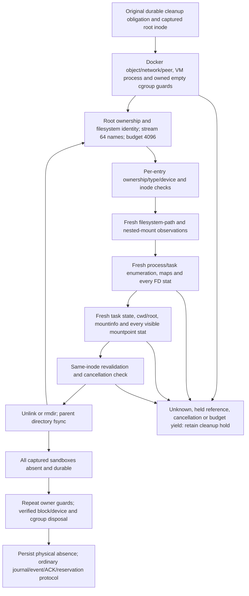

# Runnerd09 metadata cleanup: measurements and recovery

**Release gate remains open.** Neither the measured baseline nor the real-guard
stress run establishes cleanup completion within the existing 110-second
qualification deadline. No admission, dispatch or qualification gate is enabled
by these changes. No consolidated negative reference cache is implemented.

## Current implementation and dependency map

The optimization candidate remains serial. It reuses deterministic decoding and
buffer storage while preserving fresh observations and every per-entry guard,
reference check, identity revalidation and parent fsync. It introduces no
reference fence and cannot claim atomic exclusion of new references.

The graph shows dependencies, not an atomic snapshot. A cleanup error cannot
authorize CLEANED or reservation release. Rootfs and runtime authority are not
derived from the parser cache.

### Retained optimizations

- Parse leading procfs columns into fixed-size stack arrays and iterate lines
  without allocating field/line slices. Numeric validation remains unchanged.
- Construct the immutable mount-escape decoder once, with an identity fast path
  for strings containing no backslash. It contains no host observations.
- Within one cleanup request, memoize decoded maps/mountinfo by **exact newly
  read bytes**. The key contains the complete current input, not PID, TID,
  namespace ID, a hash alone, target inode or a prior negative result. Every
  task's maps and mountinfo are reopened and read again for every examination.
  Decoded mappings are a target-independent set of device/inode facts from that
  fresh input; FD, cwd/root and mountpoint stats are always repeated. Loop-device
  checks still use the streaming checker and fresh `map_files` stats.
- Bound retained decoded data to 16 MiB and 128 entries per request. Full caches
  continue fresh decoding; maps larger than 1 MiB use the existing streaming
  checker with its original per-line limit. No new acceptance size limit is
  inferred from the cache. The next request constructs a new decoder.
- Pool read-buffer capacity, reset the used length to zero, and fill it from a
  new open at offset zero through EOF. Old tails are never examined. Cache keys
  and returned decoded strings own immutable copies before buffers are reused.
  Large buffers are not retained. Read errors and cancellation remain failures.
- Record hot operation counts atomically to avoid a diagnostic mutex per stat.
  Timings, CPU, allocations, guard setup, metadata/worker setup and complete
  scenario latency remain separately reported. Known held references preserve
  `ErrQualification` and add an internal explicit reference-rejection cause.

### Safety equivalence argument and limits

| Question | Retained candidate |
| --- | --- |
| Removed redundant work | Rebuilding pure decoders, reparsing byte-identical current text, temporary allocations and repeated buffer growth |
| Authorization predicate | Same numeric inode/device matches, ownership, filesystem, mounts, all tasks/FDs/mappings, runtime/peer/cgroup guards and durability |
| Reused information | Immutable decoding rules, parsed values of an exactly matching fresh input, and empty buffer capacity; no absence decision |
| Identity | Exact string-byte equality for complete newly read content; no PID/TID/namespace stability assumption |
| Validity scope | Only the particular fresh input being evaluated in the current request; dynamic stats are never reused |
| Concurrent changes | Changed input is decoded afresh; identical input has identical decoded values. Current FD/mountpoint/cwd/root stats still execute. Changes after the last observation remain a separate non-atomic race limitation |
| PID/TID reuse or namespace changes | Every enumeration/read/stat is repeated through current procfs paths; cache lookup never uses process or namespace identity |
| Missing or unreadable state | Same fail-closed observation policy. Unknown data is not cached as safe; unsupported cache inputs fall back to the original checker |
| Crash, timeout or interruption | Cache/buffers are discarded; original durable ownership, 64-name traversal, work budget, per-removal fsync and fresh cleanup-only retry remain |
| No premature CLEANED | All predicates and physical completion checks still precede ordinary journal/event/ACK/reservation completion; failed performance and partial cleanup remain incomplete |

This argument covers equivalence of the retained computations. It is **not** an
independent security approval or proof that a process cannot acquire a reference
after the final scan and before unlink. `removeSandboxTree` still has separate
observation, inode-check and removal syscalls. The current candidate does not
close that acquisition window; do not report complete concurrent-acquisition
qualification or a new fencing guarantee from the passing earlier-phase tests.

An eight-worker leaf experiment improved prefix progress but still missed the
full-size deadline. It changes the production guard callback's concurrency
contract without an established safety argument, so it was rejected and removed
from production code. Its failed measurements remain separate exploratory
evidence. Mountpoint/FD stats were not deduplicated by stable IDs, and no
consolidated scan or privileged reference-denial mechanism was substituted.

Native coverage adds fresh-input changes, buffer truncation/EOF, cache bounds,
large-input fallback, FD/O_PATH/closed-FD mmap acquisition while a fresh maps read
is blocked, surviving-thread FD/directory/cwd/root references, and hidden mount
namespaces. The root-reference test isolates root from cwd and verifies the
positive root predicate separately; chroot-induced unresolvable mountpoints
must also retain the tree as unknown state. These cases do not stand in for a
reference acquired immediately after the final scan.

## Measured costs

The November 10 instrumented baseline used 4,096 metadata entries and 32
test-owned surviving workers, including four private mount namespaces and four
CPU-active workers, on the disposable 4-vCPU VM under a two-CPU service quota.
It kept all original per-entry checks and timed out at 110,055 ms:

| Operation | Calls | Total time |
| --- | ---: | ---: |
| `noSandboxNamespaceReferences` | 73 | 82.598 s |
| `noBlockUsers` | 73 | 26.095 s |
| Parent directory fsync | 72 | 0.966 s |
| Filesystem path resolution | 73 | 0.134 s |
| Nested mount check | 73 | 0.134 s |
| Metadata operations | 151 | 0.009 s |
| Unlink/rmdir | 72 | 0.058 s |
| Synthetic guard | 74 | 0.000058 s |

The request visited 75 entries, reaching depth two, before cancellation. These
numbers identify repeated reference inspection as the dominant measured cost;
they do not establish a general bound for all host workloads. Instrumentation
records request-local call counts and nanoseconds without changing check results
or retaining reference observations between calls.

`RUNNERD09_SANDBOX_STRESS_GUARDS=production-readonly` exercises the actual
production guard functions: Docker object absence, retained network identity and
detachment, daemon-peer continuity, complete current VM-process enumeration and
the exact owned empty cgroup's identity and hard limits. It requires the fixed
lab Docker socket through `RUNNERD09_STRESS_DOCKER_ENDPOINT` and the full retained
bridge ID through `RUNNERD09_STRESS_NETWORK_ID`. Docker operations are read-only;
each case creates and releases only a fresh empty test slice. The synthetic
prepared-state fixture has no prior live-VM witnesses, so this benchmark is not
live-VM exit, reservation, journal or production qualification evidence. Its
110-second context also bounds guard-fixture setup; logs report cleanup elapsed
time separately from that setup. Neither synthetic nor real-guard mode can use
an environment setting to bypass production guards.

The measured real-guard cases both failed their 110-second contexts:

| Case | Cleanup elapsed | Namespace scans | FD/mapping scans | Guards | Fsync |
| --- | ---: | ---: | ---: | ---: | ---: |
| Unreferenced | 109.575 s | 76.202 s | 23.822 s | 8.271 s | 1.004 s |
| Retained reference | 109.705 s | 76.233 s | 24.046 s | 8.267 s | 0.919 s |

Guard-fixture setup consumed the remaining context time before the cleanup
timers started. Both directories remained when the deadline expired. These are
failed performance assertions; the retained-reference stress case did not reach
successful reference-latency qualification. The original 110-second deadline
was not extended, and synthetic fixture teardown is separate from acceptance.

## Durable partial progress

The former 4,096-child directory rejection could permanently strand a wide
directory. There is no demonstrated signed runtime contract guaranteeing that a
legitimate metadata tree always remains below that size. The 4,096-entry budget
is now per captured directory per request. Enumeration reads at most 64 names
at once, and the existing depth limit of 32 remains enforced. A wider tree yields a non-successful cleanup
request after its bounded work, rather than failing solely because its directory
contains more than 4,096 children.

The original captured root device/inode and common durable cleanup obligation
remain authoritative. Each removed entry still receives fresh ownership,
filesystem, mount, process, descriptor, mapping and namespace checks, immediate
identity revalidation and parent fsync. The filesystem records the durable
removed prefix; there is no persisted cursor or negative reference snapshot to
trust after restart. A new request starts from the same captured directory and
repeats all guards. Newly acquired references fence the retry. A cancellation,
budget yield, foreign entry or failed check cannot produce successful absence
evidence or a CLEANED event. Normal removal refusal retains the allocation.

Native regressions cover bounded partial progress, a reference acquired before
retry, and a 4,101-child directory with a deliberately exhausted request budget.
The wide-directory test verifies bounded enumeration/yield without claiming that
thousands of removals meet the latency deadline. A subprocess regression kills
the cleanup process after one unlink and parent fsync, then uses a fresh process
and the original captured identity to finish. Under the explicit stress opt-in,
32 workers remain active across both processes. This is component process-crash
coverage, not power-loss or whole-daemon integrated recovery qualification.

With `RUNNERD09_SANDBOX_STRESS_GUARDS=production-readonly`, the crash test also
uses the actual production guards in each process. The original public fixture
and captured ownership are fsynced before execution. A fresh process opens a new
read-only Docker connection, requires the original peer/network and original
persisted cgroup identity, and repeats process/resource checks. It does not
recreate a cgroup, reset a journal, replace an enrollment key or sign a profile.
This prepared-state component fixture has no SaaS reservation or shipping-daemon
journal; do not claim that it establishes their integrated recovery behavior.

The full-size retained-reference benchmark records whether rejection was
actually reference-caused. It preserves failures, releases only its owned worker
through its process handle, then attempts a separate 110-second cleanup request
with fresh guards and the original ownership. Timeout, unrelated refusal and
synthetic teardown are never promoted to successful rejection or completion.

## Requirements for a future consolidated scan

The fast batching design is **not implemented or qualified**. An application
mutex, a renamed directory, a private path or a prior successful process scan is
not sufficient to exclude new references from unrelated host processes.

An implementation must provide a reviewed kernel-enforced quiescence argument
covering ordinary and `O_PATH` opens, existing and transferred descriptors,
memory mappings, cwd/root, hidden bind mounts, unshared thread namespaces and
the qualified host privilege model. Permission notifications alone are
insufficient: Linux v6.18's `O_PATH` open path returns before the fanotify open
permission hook. See [Linux VFS open implementation](https://github.com/torvalds/linux/blob/v6.18/fs/open.c)
and [fanotify's documented limitations](https://man7.org/linux/man-pages/man7/fanotify.7.html).
No fanotify marks or host-wide access denial are installed by this work.

A reviewable batching protocol must establish all of the following before it
can replace per-entry reference checks:

1. Persist exact execution, profile, peer, boot and captured inode ownership
   before creating a fence. Runtime admission/start fencing must be independent
   of the unrelated-host-process reference fence.
2. Install and verify that complete reference fence, with failure/cancellation
   preserving ownership. Reject unsupported kernels, filesystems, permissions,
   overflows, alternate mounts or incomplete coverage; do not fall back to
   cached negatives.
3. Inventory a bounded set of exact inode/device identities, rejecting foreign
   ownership, symlinks, filesystem crossings and unsupported aliases. Include
   directory and ancestor handles. Fence violations and existing references
   prevent destructive work.
4. Run the consolidated examination of that entire set, and keep the fence
   continuously effective through every bounded deletion batch. Repeat live
   VM/peer and inode-identity checks at batch boundaries. Prove that observer
   bookkeeping handles cannot conceal external references.
5. Fsync directory mutations before committing progress. After interruption,
   restore and verify a fresh fence and fresh observations from the original
   durable ownership record; never resume an old negative snapshot.
6. Verify final physical absence and durability, close bookkeeping handles, and
   complete normal storage/cgroup/network/reservation release. Test fence loss,
   late references, SIGKILL, power loss, peer replacement and fsync failures
   without false CLEANED or reuse.

The acceptance target remains both 4,096-entry stress cases completing with
meaningful headroom below 110 seconds, including real guards, followed by the
complete native and integrated qualification matrix. The current bounded retry
implementation improves recovery behavior but does not satisfy that latency
gate. Independent security review and production qualification remain required.
